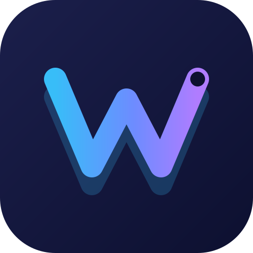

<div align="center">



<h1>Wyngthon</h1>

<p>
  <strong>Asynchronous Python library for the Wyng API</strong>
</p>

<p>
  Built on <strong>Telethon</strong> and fully adapted for the
  <strong>Wyng</strong> protocol.
</p>

<p>

<a href="https://pypi.org/project/splusthon/">
  
</a>

<a href="https://pypi.org/project/splusthon/">
  
</a>

<a href="LICENSE">
  
</a>

<a href="https://github.com/P3dro-Im/Wyngthon/stargazers">
  
</a>

<a href="https://github.com/P3dro-Im/Wyngthon/issues">
  
</a>

<a href="https://github.com/P3dro-Im/Wyngthon/actions">
  
</a>

</p>

<p>

<a href="https://p3dro-im.github.io/Wyngthon/"><strong>Documentation</strong></a>
•
<a href="https://pypi.org/project/splusthon/"><strong>PyPI</strong></a>
•
<a href="https://github.com/P3dro-Im/Wyngthon"><strong>GitHub</strong></a>
•
<a href="https://web.wyng.ir"><strong>Wyng</strong></a>

</p>

</div>

---

کتابخانه Wyngthon یک کتابخانه مدرن و قدرتمند برای **Python 3** است که بر پایه
**asyncio** توسعه یافته و امکان تعامل مستقیم با **API پیام‌رسان وینگ**
را به‌عنوان **کاربر** یا **ربات** فراهم می‌کند.

این پروژه بر پایه **Telethon** توسعه یافته و برای معماری اختصاصی وینگ
بازطراحی شده است. کتابخانه از **TL Schema (Layer 229)**،
**RSA Encryption**، **DC Routing** و **WebSocket Transport**
پشتیبانی می‌کند و تجربه‌ای سریع، پایدار و نزدیک به کلاینت رسمی ارائه می‌دهد.

> **Note:** لطفاً هنگام استفاده از این کتابخانه، قوانین و شرایط استفاده وینگ را
> رعایت کنید. مسئولیت استفاده از این پروژه بر عهده کاربر است.

## ویژگی‌ها

- پشتیبانی کامل از حساب کاربری و ربات
- مبتنی بر asyncio با کارایی بالا
- امکان استفاده به‌صورت Sync و Async
- پشتیبانی کامل از TL Schema اختصاصی وینگ
- مدیریت Session و StringSession
- پشتیبانی از WebSocket
- پشتیبانی از DC Routing
- رمزنگاری RSA و AES
- بدون نیاز به API ID و API Hash
- API مشابه Telethon برای مهاجرت آسان

## نصب

از PyPI:

```bash
pip install wyngthon
```

یا آخرین نسخه توسعه:

```bash
pip install git+https://github.com/P3dro-Im/Wyngthon.git
```

## شروع سریع

```python
from wyngthon import WyngClient
from wyngthon.sessions import StringSession

client = WyngClient(StringSession())

client.start()
```

## نمونه

```python
from wyngthon import WyngClient, events
from wyngthon.sessions import StringSession

client = WyngClient(StringSession())

@client.on(events.NewMessage)
async def handler(event):
    await event.reply("سلام 👋")

client.start()
client.run_until_disconnected()
```

ارسال پیام

```python
client.send_message(
    "username",
    "سلام از Wyngthon ❤️"
)
```

ارسال فایل

```python
client.send_file(
    "username",
    "/path/image.jpg"
)
```

دانلود رسانه

```python
message = client.get_messages("username", limit=1)[0]
message.download_media()
```

## Session ذخیره‌شده

```python
from wyngthon import WyngClient
from wyngthon.sessions import StringSession

session = "1AwA..."

with WyngClient(StringSession(session)) as client:
    print(client.get_me())
```

## وابستگی‌ها

- aiohttp
- pyaes
- rsa

اختیاری:

- cryptg (افزایش سرعت رمزنگاری)

## مستندات

مستندات کامل پروژه:

https://p3dro-im.github.io/Wyngthon/

## مجوز

این پروژه تحت مجوز **GNU GPL v3** منتشر شده است.

بخش‌هایی از این پروژه از **Telethon** (مجوز MIT) گرفته شده است؛ متن آن در فایل [NOTICE](NOTICE) آمده است.

---

<div align="center">

**Made with ❤️ by Pedro**

https://github.com/P3dro-Im

</div>
